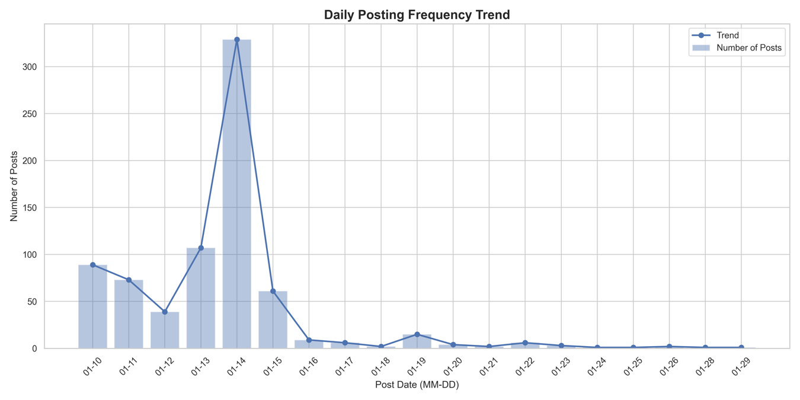

# Visualizing Social Discourse around Demumu (死了么)

**STATS 401 final project · Duke Kunshan University · Spring 2026**  
Yu Dong, Yunrong Gu, and Hongyi Qian

Demumu, originally named 死了么, is a safety check-in app designed for people who live alone. We examined how discussion of its launch and rebranding evolved across Weibo and Xiaohongshu (Rednote). The research dataset comprised 6,814 Weibo posts, 3,916 Weibo comments, and 2,732 Xiaohongshu posts.

## My contribution

I collected and cleaned Weibo data and contributed to the design and implementation of the interactive dashboard. Yunrong Gu collected and cleaned Weibo data, performed preliminary analysis, and contributed to the report. Hongyi Qian collected and cleaned Xiaohongshu data and contributed to dashboard design and implementation.

## Dashboard

| View | What it shows |
| --- | --- |
| [Engagement timeline](visualization_1.html) | Compares daily engagement across platforms with a diverging stacked area chart. |
| [Location–topic network](visualization_2.html) | Connects locations with discussion topics and encodes engagement and sentiment. |
| [Geographic influence network](visualization_3.html) | Maps regional co-commenting clusters and bridge connections. |
| [Sentiment word cloud](visualization_4.html) | Shows word prominence and likes-weighted sentiment based on SnowNLP scores. |
| [Platform keywords](visualization_5.html) | Compares distinctive terms in Weibo posts, Weibo comments, and Xiaohongshu posts using TF-IDF. |

The project observed engagement peaks around the app’s name, rebranding, and functionality. Weibo discussion in the collected sample tended to focus on the news cycle and product feedback, while Xiaohongshu posts more often framed the app through individual experiences. These patterns are exploratory and depend on the platforms and search terms sampled.



*Daily posting frequency in the Weibo sample used for this summary chart.*

## Run locally

From the repository directory:

```sh
python3 -m http.server 8000
```

Open [the dashboard](http://localhost:8000/). The chart pages load D3 and d3-cloud from public CDNs.

This portfolio edition ships aggregate engagement, network metrics, and term statistics computed from the course project data. The text views use precomputed corpus-level statistics and only show terms found in at least five records within a source. Raw posts, comments, account identifiers, and collection files are excluded.
